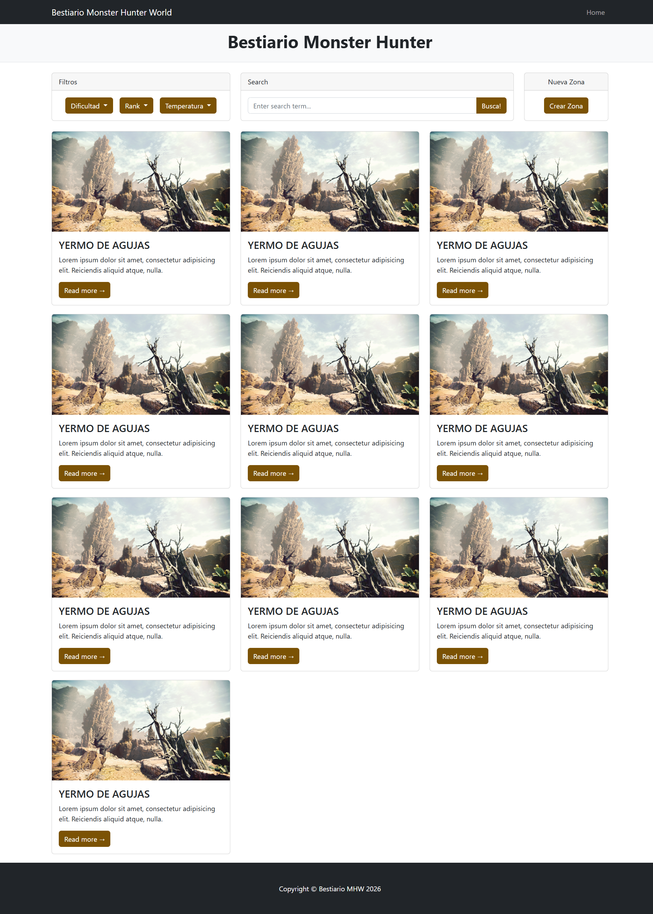
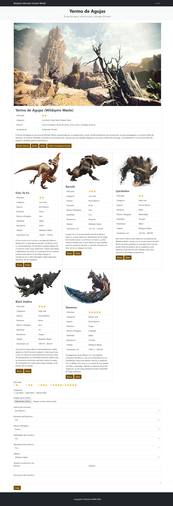
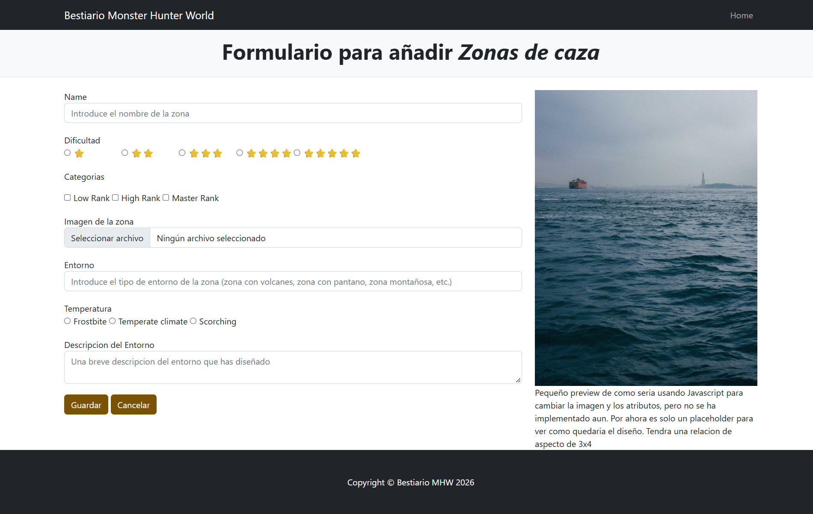

# Bestiario de Monster Hunter World

## **Integrantes del equipo de desarrollo**
|Nombre|Correo de la universidad|Usuario de Github|
|--------|----------------|--------------|
| Nicolas Gutu Gutu | n.gutu.2025@alumnos.urjc.es | nicolengo1|
|João Paulo Ortega | jp.ortega.2025@alumnos.urjc.es | OrtegaJp|
| Carlos Abraham Velasco Carmona | ca.velasco.2025@alumnos.urjc.es | veeelasco |

## **Funcionalidad**
### **Entidades**
| Principal/Zona de caza | Valores | Explicacion |
|------------------------|---------|-------------|
| Nombre | Ancient Forest, Coral Highlands, Wildspire Waste, Rotten Vale, Elder's Recess, Hoarfrost Reach, Origin Isle, Confluence of Fates, Caverns of El Dorado, Costle Schrade (string) | Todas las posibles zonas del juego |
| Dificultad | ⭐-⭐⭐⭐⭐⭐ (se procesara el valor de la base de datos y se transformara a las estrellitas correspondiendes, el valor base son tres bits, de 0 a 5 en binario) | se evaluara usando estrellitas, de 1 a 5 estrellas, 1 siendo el mas facil y 5 el mas dificil. un sistema simple de dificultad dependiendo de los monstruos que habitan la zona y de como es la zona en si |
| Categorias | LR - low rank, HR - high rank, MR - master rank (se procesara en la base de datos y devolvera un string, el dato base son dos bits, de 0 a 3 en binario)| categorias de dificultad disponibles para cada zona, puede tener multiples opciones, la dificultad original del juego |
| Imagen | url de la imagen (string) | una imagen general de la zona |
| Descripcion | un string |una descripcion simple de la zona |
| Entorno | zona con volcanes, zona con pantano, zona montañosa, zona rocosa, zona con mucho desnivel, zona muy apretada, etc | alguna informacion importante  que podria ayudar al jugador |
| Temperatura | Frostbite , Temperate climate, Scorching (un string, solo una opcion, igual, se procesara en la base de datos y se devolvera el string, el dato base son 2 bits, de 0 a 2 en binario) | equivalente a necesitar pocion de calor, no pocion, pocion de frio |
##
| Secundaria/Criaturas Monstruosas | Valores | Explicacion |
|------------------------|---------|-------------|
| Nombre | un string | el nombre de cada bestia |
| Dificultad | ⭐-⭐⭐⭐⭐⭐ (igual, se procesa y se devuelve, 3 bits de 0 a 4 en binario) | se evaluara usando estrellitas, de 1 a 5 estrellas, 1 siendo el mas facil y 5 el mas dificil. dificultad general de el monstruo. Una unica opcion |
| Categorias | LR - low rank, HR - high rank, MR - master rank (igual, se procesa y se devuelve, 2 bits, de 0 a 2) | categorias de dificultad disponibles para cada monstruo, la dificultad original del juego, puede ser multiples opciones |
| Imagen | url de la imagen | imagen del monstruo |
| Especie de criatura | Bird Wyvern, Brute Wyverns, Fanged Beasts, Fanged, Wyverns, Flying Wyverns, Piscine Wyverns, Elder Dragons (se procesa y se devuelve, 3 bits, de 0 a 7| especie de la bestia, solo puede ser una unica especie |
| Elementos | Fire, Water, Thunder, Ice, Dragon, None (procesado, 3 bits, de 0 a 5) | un string con uno/multiples valores, es el "tipo" de monstruo |
| Efectos inflingidos | Poison, Stun, Paralysis, Sleep, Blastblight, Bleeding, Waterblight, None (procesado, 3 bits, de 0 a 7)| un string con uno/multiples valores |
| Debilidades | Fire, Water, Thunder, Ice, Dragon, None (procesado, 3 bits, de 0 a 5) | un string con uno/multiples valores |
| Resistencias | Fire, Water, Thunder, Ice, Dragon, None (procesado, 3 bits, de 0 a 5) | un string con uno/multiples valores |
| Habitat | Cualquier habitat, solo 1 | un string con un valor/multiples  |
| Tamaño | Float, min 482.63cm  ~ Max 257 000.0 cm | cada criatura puede tomar un valor entre un min y max especificado |
| Informacion en forma de texto | un string | informacion adicional sobre el monstruo y algun detalle |
 
### **Buscador, Filtrado  o categorización**
- Buscador: El usuario podra buscar una zona de caza en especifico por su nombre
- Filtrado o Categorización: El usuario podra filtrar las zonas por dificultad o rank (LR, HR, MR)

### **Imagenes**
 Zona de caza -  ejemplo
 
 
 Criaturas  -  ejemplo

 ##### **Opcional**
    *- Cada monstruo tendra una cajita con 3 checkboxes para marcar: 1- si ha sido derrotado, 2- si se ha derrotado a la criatura en su tamaño mas pequeño, 3- si se ha derrotado a la criatura en su tamaño mas grande*

## Practica 1
   ### Capturas de pantalla de las paginas

   Pagina principal
   

   Pagina details (secundaria)
   )

   Pagina del form para entidades principales
   

   ### Participación de miembros
   - Carlos
      - Descripcion:  Crear la primera iteracion del Readme.md y mantenerlo actualizado, implementar las entidades secundarias con sus datos en la pagina de detalle, esquematizacion de la pagina web con paint
      - Commits mas importantes:
         1. README actualizado fase de preparación
            Miembros del equipo y funcionalidades de la web -- 59edaf9
            link: https://github.com/CodeURJC-FW-2026-27/webapp13/commit/59edaf9566725680057cad569b751106d1777dc5

         2. añadidos atributos de entidades secundarias en details.html -- 7410e03
            link: https://github.com/CodeURJC-FW-2026-27/webapp13/commit/7410e03231330a01199e8c6732159cc5cf01e4bb

         3. modificado botones y disposicion de elementos y nav en details.html, borrado detail.css -- aa876ee
            link: https://github.com/CodeURJC-FW-2026-27/webapp13/commit/aa876eef02d33c338221f792abef9d6c9df74d01
         
         4. redireccion formIndex->main, Readme actualizado, links y search bar eliminados de detail -- 7726625
            link: https://github.com/CodeURJC-FW-2026-27/webapp13/commit/7726625c1d6bdd98b19d52e4b22d165d683044a1

         5. botones desplegables filtros en index.html, actualizacion form en formIndex --  b306deb
            link: https://github.com/CodeURJC-FW-2026-27/webapp13/commit/b306debaf8301cae997aed4a3298380deaaf90f6

      - Ficheros en los que más he participado:
         1. details.html https://github.com/CodeURJC-FW-2026-27/webapp13/blob/main/MHW_MonsterChecklist/details.html
         2. Readme.md https://github.com/CodeURJC-FW-2026-27/webapp13/blob/main/README.md
         3. index.hmtl https://github.com/CodeURJC-FW-2026-27/webapp13/blob/main/MHW_MonsterChecklist/index.html
         4. formIndex.html https://github.com/CodeURJC-FW-2026-27/webapp13/blob/main/MHW_MonsterChecklist/formIndex.html
          

   - Joao Ortega
      - Aportaciones:
         
         1. Adaptación inicial del template de hábitats: partió de la plantilla base y realizó cambios en la estructura visual, el sidebar, los estilos y algunos recursos gráficos para ajustarla al proyecto -- bc31cda ,  ab831b3 .
            link: https://github.com/CodeURJC-FW-2026-27/webapp13/commit/bc31cda662de8e28c97022fafab40a9adc97bca3
            link: https://github.com/CodeURJC-FW-2026-27/webapp13/commit/ab831b3c3f4eedd6b6cc98c77f5a5e1ef0dafd43

         2.	Organización de la página principal: reorganizó la estructura del  index , separando mejor los elementos en columnas para mejorar la distribución del contenido y la navegación entre páginas -- e9fc446 .
            link: https://github.com/CodeURJC-FW-2026-27/webapp13/commit/e9fc446be8f9c75c9cc2524e622bcefa14b505de
         3.	Reorganización de cards y botón de nueva zona: ajustó los espacios entre tarjetas e incorporó el botón de “nueva zona de caza”, mejorando la distribución de los elementos de filtro, buscador y creación de entidades principales -- edee422 .
            link: https://github.com/CodeURJC-FW-2026-27/webapp13/commit/edee42212edc506fc292956f0794e468af46f5c9
         4. Creación del formulario de nuevas criaturas: adaptó el formulario para permitir el alta de criaturas e incorporó los botones de acción, como “cancelar” y “nueva criatura” -- 85863fb.
         link: https://github.com/CodeURJC-FW-2026-27/webapp13/commit/85863fbcd98af72d3a6b04884b247c90ffd53f14
         
      - Fichero en los que mas he participado
         1. index.hmtl https://github.com/CodeURJC-FW-2026-27/webapp13/blob/main/MHW_MonsterChecklist/index.html
         2. formIndex.html https://github.com/CodeURJC-FW-2026-27/webapp13/blob/main/MHW_MonsterChecklist/formIndex.html          
         3. styles.css https://github.com/CodeURJC-FW-2026-27/webapp13/blob/main/MHW_MonsterChecklist/css/styles.css
         4. 
         5. 

   - Nicolas
      - Descripcion:  Al principio tuvimos un commit grupal en mi cuenta (usamos una extension para escribir codigo en mi portatil).
         Tuve gran influencia en el tema, el contenido y datos de la pagina (especificados en el README) y un poco el formato de index html y details.
         Me ocupe principalmente de los form, de el archivo formindex.html y el form de details.html y a estructura de las columnas y el grid.
         Estandarizacion de codigo y forms y contenido de entidades principales y secundarias

      - Commits mas importantes:
         1. Primer prototipo de README, entidades principales y secundarias y todos los detalles de la pagina
         https://github.com/CodeURJC-FW-2026-27/webapp13/commit/60518ca20aa1d4d73ca30b357e03e2d8b585f559

         2. Primer commit realmente importante (aportacion de todos, escribimos codigo en mi portatil en clase)
         Definicion de las bases de la pagina y primer prototipo
         https://github.com/CodeURJC-FW-2026-27/webapp13/commit/8428e9bb0780df67f7a0ff4771fc7e09107fe3f2

         3. Homogenizacion de los forms y forma final. Cambio de los rows y columnas y algun que otro retoque
         https://github.com/CodeURJC-FW-2026-27/webapp13/commit/dfff6b27f25e209a226cca624c8aa4ee00e8e32b

         4. Cambio en las columnas y la estructura de la pagina con el grid de bootstrap
         https://github.com/CodeURJC-FW-2026-27/webapp13/commit/8e3fa08db1997dc02cecbb7f8df5a4f7327087b2

         5. Añadido del form en la pagina de details y un poco de homogenizacion con el otro form
         https://github.com/CodeURJC-FW-2026-27/webapp13/commit/19a40d312f6a666c5aa99df801455708e8511a5b

      - Fichero en los que mas he participado
         2. Readme.md https://github.com/CodeURJC-FW-2026-27/webapp13/blob/main/README.md
         1. formIndex.html https://github.com/CodeURJC-FW-2026-27/webapp13/blob/main/MHW_MonsterChecklist/formIndex.html
         3. index.hmtl https://github.com/CodeURJC-FW-2026-27/webapp13/blob/main/MHW_MonsterChecklist/index.html
         4. details.html https://github.com/CodeURJC-FW-2026-27/webapp13/blob/main/MHW_MonsterChecklist/details.html
         5. los form.css e index.css 
            https://github.com/CodeURJC-FW-2026-27/webapp13/blob/main/MHW_MonsterChecklist/css/form.css
            https://github.com/CodeURJC-FW-2026-27/webapp13/blob/main/MHW_MonsterChecklist/css/index.css
